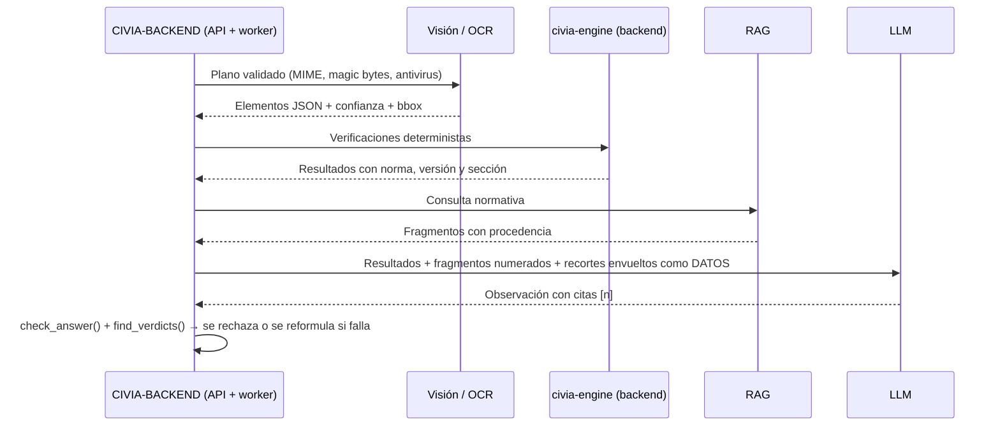

# Diseño de la capa de IA

## Responsabilidades

| Hace | No hace |
|---|---|
| Preprocesar planos (PDF, imagen, foto con corrección de perspectiva) | Calcular cargas, esfuerzos o dimensionamiento |
| OCR de cotas, tablas y rótulos | Decidir si algo "es seguro" o "cumple" |
| Detectar elementos (columnas, vigas, zapatas, ejes, cotas) con confianza y `bbox` | Inventar artículos de norma o fórmulas |
| Recuperar fragmentos normativos (RAG) y citarlos | Responder sin fuente |
| Redactar observaciones en lenguaje de revisión | Seguir instrucciones escritas dentro de un plano |

## Flujo de análisis (Fase 1)



## Salida de detección (contrato)

```json
{"id":"C-01","tipo":"columna","seccion_cm":[30,30],"nivel":"N+0.00→N+3.00",
 "refuerzo_long":"8Ø16","estribos":"Ø8@10","fc_MPa":28,"confianza":0.93,
 "origen":{"plano":"E-02","pagina":1,"bbox":[0,0,0,0]}}
```

Los elementos con confianza baja (< 0.75, a calibrar con el dataset de evaluación) se marcan
"revisar" en la interfaz.

## Seguridad (OWASP Top 10 for LLM Applications)

| Riesgo | Control |
|---|---|
| LLM01 Prompt injection | `untrusted.wrap_document`: delimitador aleatorio por petición, neutraliza marcado falso, señala frases de inyección para auditoría |
| LLM02 Manejo inseguro de la salida | La salida nunca se ejecuta; `check_answer` exige citas válidas; `find_verdicts` bloquea veredictos |
| LLM06 Divulgación de información | Minimización: se envían recortes y fragmentos necesarios, nunca el proyecto completo; prompts y respuestas al audit log |
| LLM09 Dependencia excesiva | Aviso obligatorio "Requiere revisión y aprobación del profesional responsable" |
| LLM10 Consumo sin límites | Límites de tokens, coste y tasa por organización (Fase 1) |

Privacidad: acuerdo de tratamiento de datos con el proveedor, sin entrenamiento con datos de
clientes, y opción de modelo local para despliegues sensibles.

## Evaluación

- Detección: precisión/recall por tipo de elemento sobre un dataset de planos anotados.
- OCR: tasa de error por carácter en cotas y refuerzos.
- RAG: fidelidad de citas (cada cita apoya la afirmación) y tasa de "sin soporte" correcta.

Los datasets de planos de clientes y las normas con derechos restringidos **no** se suben al
repositorio (ver `.gitignore`).
